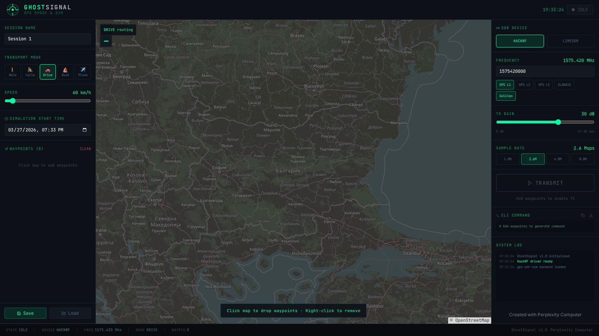
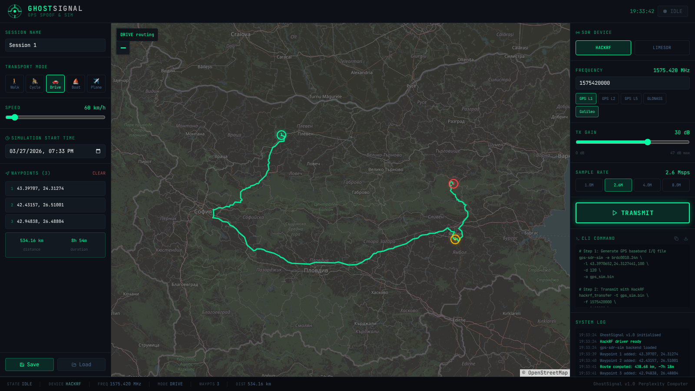
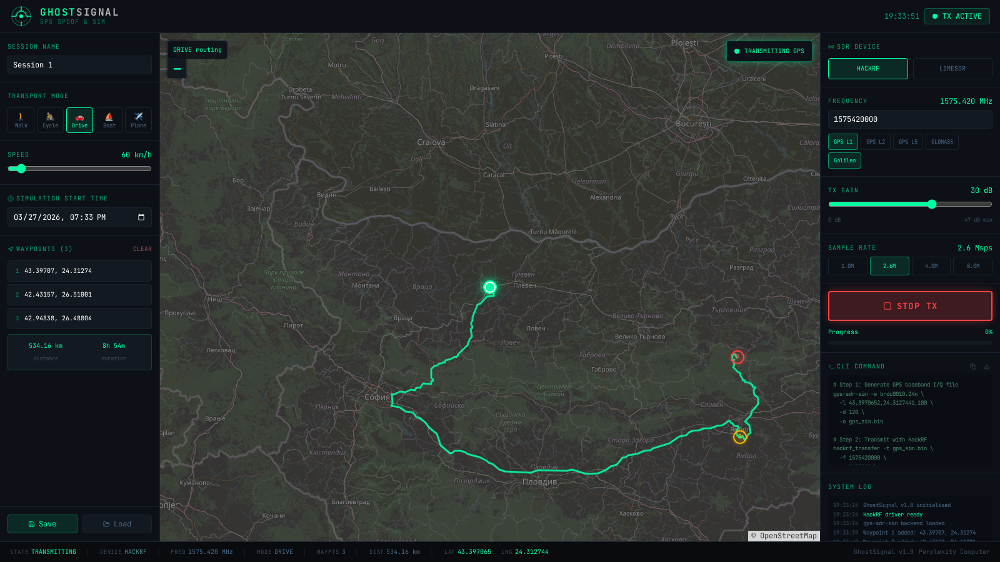

# GhostSignal 🛰️ v2

**GNSS signal simulation & SDR transmission for authorized research, development, and testing.**

GhostSignal is a desktop application (PyQt6) for planning a GNSS route on a
map, generating the corresponding baseband I/Q signal, and transmitting it
with an SDR (HackRF One or LimeSDR). v2 is a full modular rewrite of the
original single-file tool: the core logic (routing, motion, signal-generator
and SDR command building, session persistence, RINEX handling) lives in a
Qt-free `ghostsignal/core` + `ghostsignal/backends` + `ghostsignal/sdr`
package tree that is unit-tested without a display, and a thin `ghostsignal/ui`
layer on top of it drives the actual GUI. A `ghostsignal-cli` headless entry
point runs the same pipeline with no Qt dependency at all.

> ## ⚠️ Legal / authorization notice
>
> GhostSignal **transmits real RF energy** that mimics live GNSS signals.
> Transmitting (or even radiating unintentionally) a spoofed GNSS signal
> outside a properly shielded environment, or without explicit authorization,
> is illegal in most jurisdictions and can interfere with safety-of-life
> navigation systems (aviation, maritime, emergency services).
>
> **Use GhostSignal only in authorized research, development, and testing
> environments** — Faraday-cage labs, sanctioned drone-test ranges, and
> academic work carried out with proper permission. Never transmit outside a
> shielded enclosure without explicit legal authorization.
>
> Before any **real** (non-planner) transmit, the application shows a modal
> authorization dialog that requires you to affirmatively check "I am
> authorized to transmit in a shielded/Faraday environment" before the OK
> button is even enabled. This gate cannot be skipped from the GUI. The
> headless CLI has no such gate — you are responsible for only driving it in
> an authorized, shielded setup.

---

## Screenshots

The screenshots below are from the v1 UI. v2 keeps the same dark "terminal"
layout (left waypoint/session panel, center map, right SDR/CLI/log panel) and
adds a constellation selector, a planner-only toggle, and an ephemeris
download button to the right panel — not pictured here.

### Idle — Map & Controls


### Route Simulation — Multi-Waypoint Drive Route


### Transmitting — Live Position Playback


---

## What's actually in v2

| | v1 | v2 |
|---|---|---|
| Route playback | Cosmetic timer; `gps-sdr-sim` only ever got a **static** `-l lat,lng` fix | Real continuous moving-fix: a 10 Hz trajectory is written as a `gps-sdr-sim`/`galileo-sdr-sim` user-motion file (`-x`/`-u`) |
| "TRANSMIT" button | Only animated a dot — the real work was a copy-paste shell script you ran by hand | Actually runs the generator and transmitter as child processes, with live log streaming and a hard Stop |
| Multi-constellation | Claimed GLONASS/Galileo/BeiDou via frequency presets, but the only backend was GPS-only `gps-sdr-sim`, which always emits L1 C/A regardless of the selected frequency | GPS and Galileo are real, separate backends; GLONASS/BeiDou are real plugin seams to a configurable external multi-GNSS tool, clearly marked experimental (see below) |
| Code | One ~1,180-line file | Modular package: `core/` (pure, no Qt), `backends/`, `sdr/`, `ui/`, `workers/`, `headless/` |

---

## Features

- **Interactive map** — Leaflet map embedded via `QWebEngineView`; click to drop waypoints, drag to reposition, multiple waypoints per route.
- **Real road routing** — walk/cycle/drive routes are fetched from the public OSRM API (actual road/path geometry); boat/plane use a straight-line great-circle route.
- **Continuous route playback (the real v2 win)** — the route + speed profile is resampled into a 10 Hz trajectory and written as a `gps-sdr-sim`/`galileo-sdr-sim` **user-motion file**, so the generated signal is a genuinely moving fix along the whole route, not a single static point.
- **Speed profiles** — constant speed, or a trapezoidal accel/cruise/decel profile (configurable accel/decel in m/s²).
- **NMEA replay** — load a `.nmea`/`.txt`/`.log` file; `$GPGGA`/`$GNGGA` fixes are parsed into a route, bypassing OSRM entirely.
- **Session save/load** — save waypoints, transport, speed profile, start time, and SDR settings as a JSON file (schema v2); loading an old v1-style session JSON is automatically migrated.
- **RINEX ephemeris downloader** — "Download ephemeris" resolves the daily broadcast ephemeris for the session date and tries, in order: local cache → a no-auth BKG/IGS mirror → CDDIS. **CDDIS requires an Earthdata login**, and GhostSignal does not currently perform authenticated CDDIS requests — in practice the no-auth mirror satisfies most dates; if you need CDDIS specifically, download the file yourself and point `--nav`/the nav file field at it.
- **Real HackRF / LimeSDR execution** — the generator and transmitter run as actual child processes (`QProcess` in the GUI, `subprocess` headless), with merged stdout/stderr streamed live to the on-screen log, and a hard Stop that kills both processes.
- **Planner-only mode** — checked by default; generates and previews the exact CLI script without ever invoking the transmitter. Flip it off to arm a real transmit.
- **Auto-generated CLI script** — the CLI tab always shows the exact two-step shell command (generate, then transmit) for the current configuration; Copy to clipboard or Save as `.sh`.
- **Authorization gate** — see the legal notice above; required before any real (non-planner-only) transmit.
- **Headless CLI** — `ghostsignal-cli` runs the identical pipeline against a saved session with no Qt import at all, for scripting/CI/Docker.

### Frequency control vs. constellation — don't confuse them

The right panel has a numeric TX frequency field with quick-set buttons
(`L1`, `L2`, `L5`, `GLONASS`). These buttons only change the number handed to
the SDR transmitter as its center frequency (`hackrf_transfer -f …`). They
**do not** change what signal is generated — the GPS backend (`gps-sdr-sim`)
always emits L1 C/A baseband content, regardless of what frequency you tune
the radio to. To actually change which GNSS signal is produced, use the
**Constellation** selector (GPS/Galileo/GLONASS/BeiDou), not the frequency
presets. Leave the frequency at the GPS L1 default (1575.42 MHz) unless you
have a specific RF reason to retune the carrier.

---

## Multi-constellation — the honest picture

GhostSignal v2 has a real backend seam (`ghostsignal/backends/`, one
`SignalGenerator` subclass per constellation) so additional GNSS signal
generators can be plugged in without touching the pipeline, UI, or session
format. Today:

| Constellation | Backend | Status |
|---|---|---|
| **GPS** | [`gps-sdr-sim`](https://github.com/osqzss/gps-sdr-sim) | **Real.** The original backend, driven with a continuous user-motion file. |
| **Galileo** | [`galileo-sdr-sim`](https://github.com/harshadms/galileo-sdr-sim) (E1B/C) | **Real**, separate binary and backend. |
| **GLONASS** | external multi-GNSS tool (default target: `gnss-signal-simulator-rs`) | **Experimental / plugin seam only.** The command-building, session plumbing, and UI are fully implemented, but `available()` reports false — and the UI greys the option out — unless you configure a working external binary via `GNSS_MULTI_SIM`. No such tool ships with GhostSignal. |
| **BeiDou** | same external multi-GNSS tool | **Experimental / plugin seam only.** Same caveat as GLONASS. |

In other words: **GPS and Galileo work out of the box once their simulators
are built; GLONASS and BeiDou require you to separately obtain, build, and
configure a multi-GNSS tool that speaks GhostSignal's `--system glonass`/
`--system beidou` convention.** Nothing about GLONASS/BeiDou is faked —
the seam is real and tested — but no working binary is bundled or
guaranteed to exist for your platform.

---

## Running it

### GUI

```powershell
python -m ghostsignal
# or, after `pip install -e .`, the console entry point:
ghostsignal
```

### Headless CLI

```powershell
ghostsignal-cli run session.json [--dry-run] [--generate-only] [--nav FILE] [--work-dir DIR]
```

- `--dry-run` — build the generate/transmit commands and print them (two
  lines: the generator argv, then the transmitter argv), without running
  anything or writing the motion file.
- `--generate-only` — write the motion file and run the generator, but skip
  the transmit step (useful for IQ-generation-only hosts, e.g. Docker).
- `--nav FILE` — path to the RINEX broadcast ephemeris file (default `brdc.nav`).
- `--work-dir DIR` — where the motion file and generated `.bin` are written
  (default `.`).

Example:

```powershell
ghostsignal-cli run session.json --dry-run --nav brdc.nav
# gps-sdr-sim -e brdc.nav -x .\motion.csv -T 2026/01/01,00:00:00 -d 347 -s 2600000 -b 8 -o .\gps_sim.bin
# C:\Program Files\PothosSDR\bin\hackrf_transfer.exe -t .\gps_sim.bin -f 1575420000 -s 2600000 -a 1 -x 30 -R
```

---

## Setup (Windows-first)

GhostSignal is developed and tested on Windows; this is the primary setup
path. It should run on Linux/macOS as well (pure Python + PyQt6), but build
scripts and auto-detected tool paths below are Windows-specific.

### 1. Python 3.12 virtual environment

PyQt6 does not currently ship wheels for Python 3.14. Use **Python 3.12**:

```powershell
py -3.12 -m venv .venv
.venv\Scripts\Activate.ps1
python -m pip install --upgrade pip
python -m pip install -e ".[dev]"
```

(`scripts/setup-venv.ps1` does the same thing.) This installs the GUI
(`ghostsignal`) and headless (`ghostsignal-cli`) console entry points via
`pyproject.toml`.

### 2. Build the signal generators

**A C compiler is required and is NOT bundled.** You need a mingw-w64/MSYS2
`gcc` toolchain on `PATH` (e.g. via Git Bash's MSYS2 install, or MSYS2
directly) before running either build script.

```powershell
scripts\build-gps-sdr-sim.ps1       # clones osqzss/gps-sdr-sim, compiles gps-sdr-sim.exe
scripts\build-galileo-sdr-sim.ps1   # clones harshadms/galileo-sdr-sim, prints CMake build steps
```

`build-gps-sdr-sim.ps1` clones the repo if missing and compiles it with a
recompiled, larger `USER_MOTION_SIZE` (default 36000 samples = 3600 s at
10 Hz) so continuous routes aren't capped at the stock 300-second buffer.
It prints the path to set as `$env:GPS_SDR_SIM` when done.

`build-galileo-sdr-sim.ps1` clones `harshadms/galileo-sdr-sim` (CMake-based)
and prints the MinGW/MSYS2 build commands to run from a shell with that
toolchain, then the `$env:GALILEO_SDR_SIM` path to set.

Neither script attempts to build a GLONASS/BeiDou tool — see the
multi-constellation table above.

### 3. SDR hardware

- **HackRF One** — install [PothosSDR](https://github.com/pothosware/PothosSDR)
  or the standalone HackRF Windows drivers. GhostSignal auto-detects
  `C:\Program Files\PothosSDR\bin\hackrf_transfer.exe` if present.
- **LimeSDR** — install LimeSuite / SoapySDR with the LMS7 driver module;
  GhostSignal drives it via `SoapySDRUtil`-style CLI args.

### 4. Run

```powershell
python -m ghostsignal
```

---

## Tool path overrides

By default each external tool is resolved by (1) an explicit override,
(2) an environment variable, (3) the known PothosSDR install directory,
(4) falling back to the bare command name on `PATH`. Set these if a tool
isn't where GhostSignal expects it:

| Variable | Tool |
|---|---|
| `GPS_SDR_SIM` | `gps-sdr-sim` binary |
| `GALILEO_SDR_SIM` | `galileo-sdr-sim` binary |
| `GNSS_MULTI_SIM` | external multi-GNSS tool used for GLONASS/BeiDou |
| `HACKRF_TRANSFER` | `hackrf_transfer` binary |
| `SOAPY_SDR_UTIL` | SoapySDR-based LimeSDR CLI tool |

```powershell
$env:GPS_SDR_SIM = "C:\path\to\gps-sdr-sim.exe"
```

---

## Headless / Docker

`ghostsignal-cli` imports no Qt module, so it runs in a plain Python
container. The included `Dockerfile` builds `gps-sdr-sim` from source (with
a large `USER_MOTION_SIZE`) and sets `GPS_SDR_SIM` automatically; `docker
compose up` runs `ghostsignal-cli run /work/session.json --generate-only
--nav /work/brdc.nav --work-dir /work` against a mounted `./work` directory.

**This image is for IQ generation only.** It does not include Galileo or
multi-GNSS tooling, and it is not set up for a transmitter. Reliable live
USB SDR transmit from a Windows container is not supported — keep live TX on
the host, and use Docker/headless only to generate `.bin` files you then
transmit from a machine with real SDR hardware attached (or run
`ghostsignal-cli run ... --generate-only` directly on the host if you don't
need the isolation).

---

## Architecture

```
ghostsignal/
├─ core/            # pure Python, no PyQt import anywhere (enforced by a test)
│  ├─ geo.py         haversine, LLA<->ECEF, interpolation
│  ├─ models.py      Waypoint, Route, TrajectoryPoint, SpeedProfile, SdrConfig, Session
│  ├─ routing.py      OSRM client + straight-line routing
│  ├─ motion.py       Route + SpeedProfile -> 10 Hz trajectory; motion-file writers
│  ├─ nmea.py         .nmea track parsing -> Route
│  ├─ cli.py          pure argv / shell-script builders
│  ├─ session.py      Session <-> JSON (schema v2), v1 session migration
│  └─ rinex.py        ephemeris filename resolution, mirror fallback, download+cache
├─ backends/         # SignalGenerator implementations (gps_sdr_sim, galileo_sdr_sim, glonass, beidou) + registry
├─ sdr/              # SdrTransmitter implementations (hackrf, limesdr)
├─ pipeline.py       # generate -> transmit orchestrator (dry-run friendly)
├─ ui/               # PyQt6: main_window, left/right/map panels, dialogs, assets
├─ workers/          # QThread/QProcess wrappers: OSRM fetch, pipeline execution, map playback
└─ headless/cli.py   # `ghostsignal-cli` — same core+pipeline, no Qt
```

A test (`tests/test_architecture.py`) asserts that `core/`, `backends/`,
`sdr/`, and `headless/` never import `PyQt6`, which is what makes the
headless CLI and the Docker image possible.

---

## Testing

```powershell
$env:QT_QPA_PLATFORM = "offscreen"
python -m pytest -q
```

The suite covers pure-core logic (geo, motion/speed-profile math, routing
with mocked HTTP, NMEA parsing, session round-trip + v1 migration, RINEX
filename/fallback logic, backend `available()`/argv shape), a dry-run
pipeline test that assembles real generate+transmit argv without touching
hardware, the architecture (no-PyQt-in-core) rule, and PyQt6 widget/import
smoke tests run offscreen.

---

## Credits

- [gps-sdr-sim](https://github.com/osqzss/gps-sdr-sim) by Takuji Ebinuma (osqzss) — GPS L1 C/A signal generator
- [galileo-sdr-sim](https://github.com/harshadms/galileo-sdr-sim) by harshadms — Galileo E1B/C signal generator
- [HackRF](https://github.com/greatscottgadgets/hackrf) by Great Scott Gadgets
- [Leaflet](https://leafletjs.com/) — interactive maps
- [OpenStreetMap](https://www.openstreetmap.org/) contributors and [CARTO](https://carto.com/) — map tiles/data
- [OSRM](http://project-osrm.org/) — Open Source Routing Machine

---

## License

MIT License — see [LICENSE](LICENSE) for details.
